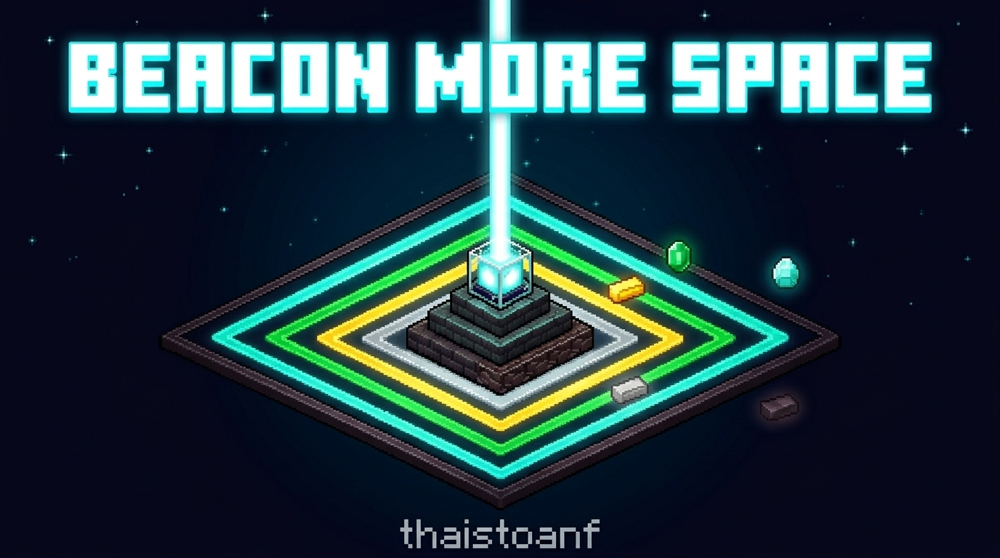

<p align="center">
  
</p>

<h1 align="center">Beacon More Space</h1>

<p align="center">
  <strong>Beacon range that scales with the payment item you use.</strong>
</p>

<p align="center">
  
  
  
  <a href="https://github.com/LeThaiToan2k4"></a>
  <a href="https://ko-fi.com/thaistoanf"></a>
</p>

<p align="center">
  <a href="#english">English</a> | <a href="#tieng-viet">Tiếng Việt</a>
</p>

---

<a id="english"></a>

# English

## 1. Introduction

In vanilla Minecraft, the Beacon effect range depends only on the pyramid level. The item you pay
to activate the Beacon makes no difference: an Iron Ingot and a Netherite Ingot give exactly the
same range, so there is no reason to spend rarer materials.

**Beacon More Space** makes the payment item matter. The material you place in the Beacon payment
slot when you confirm effects sets a permanent range bonus for that Beacon. Rarer materials cover
more space, which helps on large bases, farms, and builds.

## 2. Description and Range Table

### Formula

```
Base Range  (vanilla) = beaconLevel * 10 + 10
Bonus Range (payment) = Iron +0 | Gold +10 | Emerald +20 | Diamond +30 | Netherite +50
Total Radius R        = Base Range + Bonus Range
```

### Range table (radius in blocks)

| Payment Item    | Bonus | Level 1 | Level 2 | Level 3 | Level 4 |
| --------------- | :---: | :-----: | :-----: | :-----: | :-----: |
| Iron Ingot      |  +0   |   20    |   30    |   40    |   50    |
| Gold Ingot      |  +10  |   30    |   40    |   50    |   60    |
| Emerald         |  +20  |   40    |   50    |   60    |   70    |
| Diamond         |  +30  |   50    |   60    |   70    |   80    |
| Netherite Ingot |  +50  |   70    |   80    |   90    |   100   |

### Bounding box behavior

The vanilla effect area shape is kept. Only the radius changes:

- **Horizontal (X and Z):** the area extends `R` blocks in every horizontal direction from the Beacon.
- **Downward (-Y):** the area extends `R` blocks below the Beacon.
- **Upward (+Y):** the area stretches upward by the full world height (at least `+256` blocks), the same as vanilla.

### Independent multi-beacon operation

Each Beacon stores its own payment tier. On a shared pyramid (for example six Beacons on a 10x11
pyramid), every Beacon applies its effects with its own radius, based on the last item used to
confirm effects in that Beacon. Changing one Beacon never affects the others.

The tier is saved with the Beacon block data, so it persists through world reloads and server
restarts. It only changes when a player confirms effects in the Beacon GUI with a new payment item.

## 3. How to Use and the GUI Indicator

### Step by step

1. Build a Beacon pyramid (Level 1 to 4) as usual and place the Beacon on top.
2. Open the Beacon GUI.
3. Choose a primary effect (and a secondary effect at Level 4).
4. Place one payment item in the payment slot: Iron Ingot, Gold Ingot, Emerald, Diamond, or Netherite Ingot.
5. Check the **Preview Range** line to see the range this item will give.
6. Click **Confirm**. The item is consumed, and the Beacon now uses the new tier and range.

### Visual GUI indicator

The empty lower part of the **Secondary Power** panel shows:

- **Tier:** the active material tier of this Beacon (for example `Tier: Diamond`).
- **Range:** the current effect radius and bonus (for example `Range: 80 blocks (+30)`).
- **Preview Range:** shown when an item is in the payment slot, before you confirm (for example `Preview Range: 100 blocks (+50)`).

The payment item icons at the bottom of the GUI are outlined. A green outline marks the active
tier and a yellow outline marks the previewed tier. Hover over the indicator to see a tooltip with
the pyramid level and the full range list for every material at the current level.

If you join a server that does not have the mod, no indicator is shown, because the server has no
tier data to send.

## 4. Installation and Requirements

### Requirements

| Component              | Version               |
| ---------------------- | --------------------- |
| Minecraft Java Edition | 1.20.1                |
| Java                   | 17 or newer           |
| Fabric Loader          | 0.20.1 or newer       |
| Fabric API             | Matching 1.20.1 build |

### Installation

1. Install **Java 17**.
2. Install **Fabric Loader** for Minecraft 1.20.1 from the official Fabric website.
3. Download **Fabric API** for 1.20.1.
4. Copy `beaconmorespace-fabric-1.20.1-1.0.0.jar` and the Fabric API jar into your `.minecraft/mods` folder.
   - Windows: `%appdata%\.minecraft\mods`
   - macOS: `~/Library/Application Support/minecraft/mods`
   - Linux: `~/.minecraft/mods`
5. Start Minecraft with the Fabric profile.

For multiplayer, install the mod on the **server**, where the range logic runs. Install it on
**clients** too so players can see the GUI indicator. Vanilla clients can still join a modded
server without problems; they just do not see the indicator.

### Building from source

```bash
./gradlew build
```

On Windows:

```powershell
.\gradlew.bat build
```

The mod jar is written to `build/libs/`.

## 5. Support the Author

Beacon More Space is free. If you enjoy it and want to support future updates, you can make a
voluntary donation on Ko-fi. It is never required.

**Ko-fi:** [https://ko-fi.com/thaistoanf](https://ko-fi.com/thaistoanf)

---

<a id="tieng-viet"></a>

# Tiếng Việt

## 1. Giới thiệu

Trong Minecraft gốc, phạm vi hiệu ứng của Đèn hiệu (Beacon) chỉ phụ thuộc vào cấp kim tự tháp.
Vật phẩm bạn dùng để kích hoạt không ảnh hưởng gì: Thỏi sắt và Thỏi Netherite cho phạm vi
giống hệt nhau, nên chẳng có lý do gì để dùng vật liệu hiếm hơn.

**Beacon More Space** khiến vật phẩm thanh toán trở nên có ý nghĩa. Vật liệu bạn đặt vào ô thanh
toán khi xác nhận hiệu ứng sẽ quyết định phần phạm vi cộng thêm cố định cho Đèn hiệu đó. Vật liệu
càng hiếm thì vùng phủ càng rộng, rất hữu ích cho căn cứ lớn, nông trại và công trình.

## 2. Mô tả và Bảng phạm vi

### Công thức

```
Phạm vi gốc (vanilla)     = capDenHieu * 10 + 10
Phạm vi cộng thêm         = Sắt +0 | Vàng +10 | Ngọc lục bảo +20 | Kim cương +30 | Netherite +50
Tổng bán kính R           = Phạm vi gốc + Phạm vi cộng thêm
```

### Bảng phạm vi (bán kính tính theo khối)

| Vật phẩm thanh toán | Cộng thêm | Cấp 1 | Cấp 2 | Cấp 3 | Cấp 4 |
| ------------------- | :-------: | :---: | :---: | :---: | :---: |
| Thỏi sắt            |    +0     |  20   |  30   |  40   |  50   |
| Thỏi vàng           |    +10    |  30   |  40   |  50   |  60   |
| Ngọc lục bảo        |    +20    |  40   |  50   |  60   |  70   |
| Kim cương           |    +30    |  50   |  60   |  70   |  80   |
| Thỏi Netherite      |    +50    |  70   |  80   |  90   |  100  |

### Cách tính vùng ảnh hưởng

Hình dạng vùng ảnh hưởng gốc được giữ nguyên. Chỉ có bán kính thay đổi:

- **Chiều ngang (X và Z):** vùng ảnh hưởng mở rộng `R` khối theo mọi hướng ngang tính từ Đèn hiệu.
- **Phía dưới (-Y):** vùng ảnh hưởng mở rộng `R` khối xuống dưới Đèn hiệu.
- **Phía trên (+Y):** vùng ảnh hưởng kéo lên hết chiều cao thế giới (ít nhất `+256` khối), giống bản gốc.

### Hoạt động độc lập khi có nhiều Đèn hiệu

Mỗi Đèn hiệu lưu bậc thanh toán riêng. Trên cùng một kim tự tháp (ví dụ sáu Đèn hiệu trên kim tự
tháp 10x11), mỗi Đèn hiệu áp dụng hiệu ứng với bán kính riêng, dựa trên vật phẩm cuối cùng được
dùng để xác nhận hiệu ứng ở Đèn hiệu đó. Thay đổi một Đèn hiệu không bao giờ ảnh hưởng đến các
Đèn hiệu khác.

Bậc được lưu cùng dữ liệu khối của Đèn hiệu, nên vẫn giữ nguyên khi tải lại thế giới hoặc khởi
động lại máy chủ. Bậc chỉ thay đổi khi người chơi xác nhận hiệu ứng trong giao diện Đèn hiệu bằng
vật phẩm thanh toán mới.

## 3. Hướng dẫn sử dụng và Chỉ báo trên giao diện

### Từng bước

1. Xây kim tự tháp Đèn hiệu (Cấp 1 đến 4) như bình thường và đặt Đèn hiệu lên đỉnh.
2. Mở giao diện Đèn hiệu.
3. Chọn hiệu ứng chính (và hiệu ứng phụ ở Cấp 4).
4. Đặt một vật phẩm thanh toán vào ô thanh toán: Thỏi sắt, Thỏi vàng, Ngọc lục bảo, Kim cương hoặc Thỏi Netherite.
5. Xem dòng **Xem trước** để biết phạm vi mà vật phẩm này sẽ mang lại.
6. Nhấn **Xác nhận**. Vật phẩm bị tiêu thụ và Đèn hiệu sẽ dùng bậc và phạm vi mới.

### Chỉ báo trên giao diện

Phần trống phía dưới khung **Sức mạnh phụ** hiển thị:

- **Bậc:** bậc vật liệu đang áp dụng cho Đèn hiệu này (ví dụ `Bậc: Kim cương`).
- **Phạm vi:** bán kính hiệu ứng hiện tại và phần cộng thêm (ví dụ `Phạm vi: 80 khối (+30)`).
- **Xem trước:** hiển thị khi có vật phẩm trong ô thanh toán, trước khi xác nhận (ví dụ `Xem trước: 100 khối (+50)`).

Các biểu tượng vật phẩm thanh toán ở cuối giao diện có viền đánh dấu. Viền xanh lá là bậc đang áp
dụng, viền vàng là bậc đang xem trước. Di chuột lên phần chỉ báo để xem chú thích gồm cấp kim tự
tháp và danh sách phạm vi đầy đủ của mọi vật liệu ở cấp hiện tại.

Nếu bạn vào máy chủ không cài mod, chỉ báo sẽ không hiển thị vì máy chủ không có dữ liệu bậc để gửi.

## 4. Cài đặt và Yêu cầu

### Yêu cầu

| Thành phần             | Phiên bản                |
| ---------------------- | ------------------------ |
| Minecraft Java Edition | 1.20.1                   |
| Java                   | 17 trở lên               |
| Fabric Loader          | 0.20.1 trở lên           |
| Fabric API             | Bản tương ứng với 1.20.1 |

### Cài đặt

1. Cài đặt **Java 17**.
2. Cài đặt **Fabric Loader** cho Minecraft 1.20.1 từ trang chủ Fabric.
3. Tải **Fabric API** cho 1.20.1.
4. Chép `beaconmorespace-fabric-1.20.1-1.0.0.jar` và file jar Fabric API vào thư mục `.minecraft/mods`.
   - Windows: `%appdata%\.minecraft\mods`
   - macOS: `~/Library/Application Support/minecraft/mods`
   - Linux: `~/.minecraft/mods`
5. Khởi động Minecraft bằng hồ sơ Fabric.

Khi chơi nhiều người, hãy cài mod trên **máy chủ**, nơi xử lý phạm vi. Cài thêm trên **máy khách**
để người chơi thấy chỉ báo trên giao diện. Máy khách gốc (không có mod) vẫn vào máy chủ có mod bình
thường, chỉ là không thấy chỉ báo.

### Tự build từ mã nguồn

```bash
./gradlew build
```

Trên Windows:

```powershell
.\gradlew.bat build
```

File jar của mod sẽ nằm trong `build/libs/`.

## 5. Ủng hộ tác giả

Beacon More Space hoàn toàn miễn phí. Nếu bạn thấy mod hữu ích và muốn ủng hộ các bản cập nhật sau
này, bạn có thể tự nguyện ủng hộ qua Ko-fi. Việc này không bao giờ là bắt buộc.

**Ko-fi:** [https://ko-fi.com/thaistoanf](https://ko-fi.com/thaistoanf)
